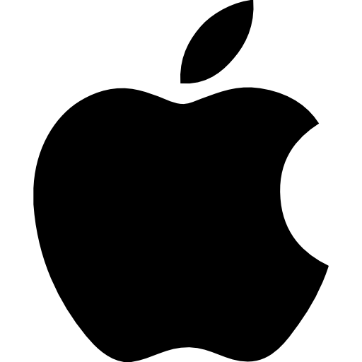
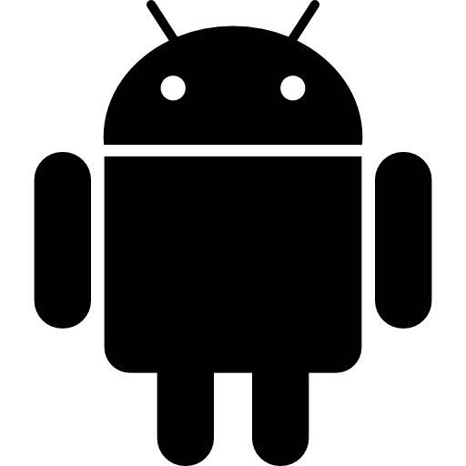
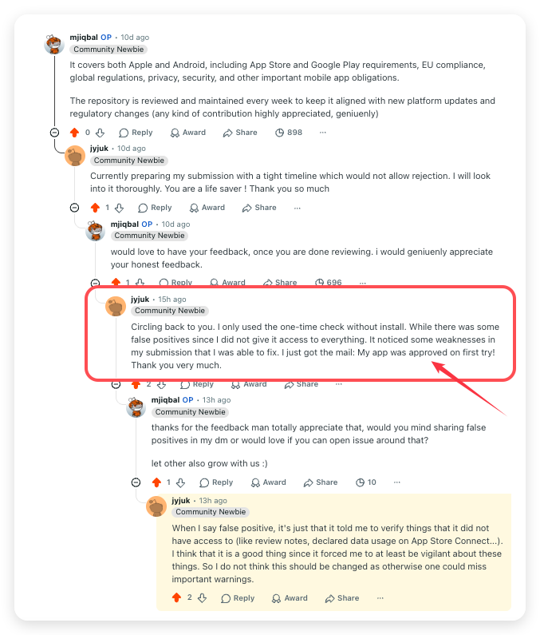
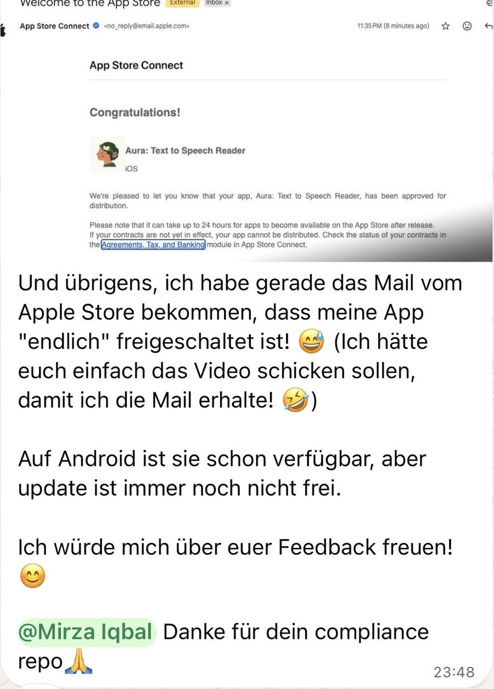

<div align="center">

&nbsp;&nbsp;&nbsp;

# Ismail's App Store Compliance Playbook

Find and review App Store and Google Play risks before submission. This playbook combines a static scanner, practical checklists, and policy references for iOS and Android. A scan can flag some risks; it cannot predict a review decision or replace checks of the running app and store account.

Maintained by **Md Ismail Hosen** ([`@Ismail554`](https://github.com/Ismail554)). This personal fork builds on work by [Mirza Iqbal](https://github.com/mjmirza); upstream attribution and the original license are retained.

[](https://developer.apple.com/app-store/review/guidelines/)
[](https://play.google/developer-content-policy/)
[](#how-you-actually-use-this)
[](https://openroots.org/licenses/ora/2.3)
[](https://github.com/Ismail554/app-store-compliance/actions)
[](.github/CONTRIBUTING.md)

[](https://github.com/Ismail554/app-store-compliance/stargazers)
[](https://github.com/Ismail554/app-store-compliance/fork)
[](https://github.com/Ismail554)

**If this saves you even one rejection, leave a star, fork it, and follow along. That is the whole ask.**

[Star this repo](https://github.com/Ismail554/app-store-compliance) &nbsp;|&nbsp; [Fork it](https://github.com/Ismail554/app-store-compliance/fork) &nbsp;|&nbsp; [Follow Ismail on GitHub](https://github.com/Ismail554)

</div>

## Start here

Pick one row. The time shown is for that first step.

| You are | Do this first | Time |
|---|---|---|
| About to submit, and you can open a terminal | Run the two commands below | 2 minutes |
| Already rejected | Open [the appeal playbook](docs/MISTAKE-PATTERNS.md#the-appeal-playbook) | 10 minutes |
| Not a developer | Open [the checklist](docs/PRE-SUBMISSION-CHECKLIST.md) and do its first two checks | 5 minutes |
| Using an AI coding tool (Claude Code, Codex, Gemini CLI, GitHub Copilot, Cursor, Grok, Qwen, Kimi and more), and want this on every submit | Go to [the install](#install-it-into-your-ai-coding-tool) | 1 minute |

The two commands. Needs git and bash. The first downloads this playbook. The second scans your app. Nothing is installed and nothing in your app is changed.

```
git clone https://github.com/Ismail554/app-store-compliance ~/repositories/app-store-compliance
bash ~/repositories/app-store-compliance/agent-os/hooks/app-store-compliance-guard.sh "/path/to/your/app"
```

Replace only `/path/to/your/app`, with the folder that holds your Xcode project or your Android app. Keep the quotes, they keep a folder name with a space in it whole. To get the path without typing it, drag the folder from Finder or your file manager into the terminal window. A small project scans in about a second, a large one can take up to a minute, and the guard prints the time it took. Findings print first, critical ones on top, each with the file and line that triggered it when there is one. The last lines tell you where you stand.

| Verdict line starts with | It means | Do next |
|---|---|---|
| `BLOCKED.` | A critical rejection risk was found | Fix each `[CRITICAL]` line using the `fix.` line under it, then run the same command again |
| `CLEAR.` | No critical risk in your code. Not an approval, the reviewer still checks what a scan cannot see | Do the account and listing checks in [the checklist](docs/PRE-SUBMISSION-CHECKLIST.md), then record them in `.app-review-readiness.json` ([why](docs/WHAT-THE-SCAN-PROVES.md)) |
| `Rule pack STALE.` (near the top) | The rules this scan used are more than 60 days old | Update the playbook with `git pull`, then run the scan again |
| `NOT CHECKED.` | No iOS or Android project was found in that folder, or the guard could not write its scan files. Run by hand this exits 1. As a hook it lets the command through | Point it at the right folder, and check the temp folder is writable. A managed Expo app with no native folders still gets its `app.json` or `app.config` read for purpose strings, the privacy manifest and Android permissions. Run `npx expo prebuild` to cover the native code too |

## What you get

A rejection can cost time through review, diagnosis, and resubmission. This playbook helps you check for known risks before you submit.

- **You can address detectable risks earlier.** The guard scans project files and reports patterns that may need a fix or human review.
- **You stop guessing at the cause.** The rejection patterns connect detected signals with relevant guidelines and suggested fixes; each finding still needs context and review.
- **Account access and runtime privacy are called out.** The checklist asks you to verify a working review account and compare privacy declarations with the app behavior, including SDKs.
- **It works whether or not you write code.** A developer wires the guard into the build. A non developer reads the plain English checklist and walks the submission safely.
- **Every claim is real.** Guideline numbers and statistics trace to a live Apple or Google source, never invented, so you are acting on the actual rules, not a guess.

Use it to reduce avoidable submission risks; a clean scan is not a prediction of approval.

## What a scan can and cannot tell you

The guard checks files and configuration for known patterns. It can flag risks visible in those inputs, but it cannot predict whether Apple or Google will approve a submission. It cannot sign in as an app reviewer to verify your demo account, and it cannot confirm every SDK runtime behavior or the data it sends. Verify reviewer access on a real build, inspect runtime traffic, and complete the account, listing, and device checks in the [pre-submission checklist](docs/PRE-SUBMISSION-CHECKLIST.md). See [what the scan proves](docs/WHAT-THE-SCAN-PROVES.md) for its limits and readiness checks.

## Install it into your AI coding tool

This puts the check in front of every submit. Your agent runs the guard before any submit command, such as an upload to App Store Connect or Google Play, and stops the command when a critical rejection risk stands. For a one-time scan, skip this section and use Start here.

One command per tool, about a minute. Needs git and bash. Every tool other than Claude Code also needs python3.

```
git clone https://github.com/Ismail554/app-store-compliance ~/repositories/app-store-compliance
bash ~/repositories/app-store-compliance/scripts/install.sh --tool all
```

`--tool all` installs into every supported tool it finds in your home folder. To pick one, pass its name instead.

| Tool | Command | What it gets | One thing to do after |
|---|---|---|---|
| Claude Code | `install.sh` | Hook, skill, `/app-store-audit` | Restart Claude Code |
| Codex CLI | `install.sh --tool codex` | Hook, skill | Run `/hooks` in Codex once and approve the new hook. Codex runs no new hook until you do |
| Gemini CLI | `install.sh --tool gemini` | Hook, skill, `/app-store-audit` | Restart Gemini CLI. The hook works from 0.22, the skill needs 0.24 or later |
| OpenCode | `install.sh --tool opencode` | Plugin, skill, `/app-store-audit` | Restart OpenCode |
| Cursor | `install.sh --tool cursor` | Hook, skill | Restart Cursor |
| GitHub Copilot CLI and Copilot in VS Code | `install.sh --tool copilot` | Hook, skill | Start a new Copilot CLI session and reload VS Code |
| GitHub Copilot cloud agent and Copilot in JetBrains | `install.sh --tool copilot-repo --repo "/path/to/your/app"` | Hook in your app's `.github/hooks` | Commit `.github/hooks` to your default branch. The cloud agent reads hooks only from there |
| Grok | `install.sh --tool grok` | Hook, skill | Start a new Grok session |
| Qwen Code | `install.sh --tool qwen` | Hook, skill, in `$QWEN_HOME` when it is set | Restart Qwen Code |
| Kimi Code | `install.sh --tool kimi` | Hook, skill | Restart Kimi Code |
| Factory Droid | `install.sh --tool droid` | Hook, skill | Start a new Droid session |
| Augment Auggie | `install.sh --tool auggie` | Hook, skill | Start a new Auggie session |
| Windsurf | `install.sh --tool windsurf` | Hook, skill | Restart Windsurf |

Every run ends with `Install verified.` only after it has fed a submit command to the hook in that tool's own payload format and seen it blocked. For OpenCode that check runs the plugin under node, so without node the run says `Installed, but not fully verified.` instead. If you see a `FAIL` line instead, fix that line and run the same command with `doctor` added.

What it writes, so you can check it.

- The guard, into that tool's own folder, for example `~/.codex/hooks/` or `~/.gemini/hooks/`.
- The skill. Claude Code reads it from `~/.claude/skills/`. Every other tool reads one shared copy in `~/.agents/skills/`.
- One hook entry in that tool's config (`~/.claude/settings.json`, `~/.codex/hooks.json`, `~/.gemini/settings.json`, `~/.cursor/hooks.json`, `~/.copilot/hooks/` or `$COPILOT_HOME/hooks/`), or for OpenCode one plugin file in `~/.config/opencode/plugins/`. Every other setting is kept, and a dated backup sits next to a file that already existed. A config that is not valid JSON or repeats a key is never rewritten. You get the exact block to paste instead.
- For Gemini CLI it also turns on `tools.enableHooks`, which Gemini needs before version 0.26 to run any hook.
- For Kimi Code it appends one marked `[[hooks]]` block to `~/.kimi-code/config.toml` (or `$KIMI_CODE_HOME/config.toml`) and never rewrites or prints the rest of that file, which can hold API keys. Uninstall removes exactly that block.
- For Factory Droid it writes to `~/.factory/settings.json` when your hooks already live there, because Droid ignores them once `~/.factory/hooks.json` exists.

Details for tools that are not wired by the installer are in [the tool support reference](docs/README-REFERENCE.md#tools-the-installer-does-not-wire).

### Or let your agent do it

Paste this into your AI coding tool. Read it first, it does exactly what the install above does, then audits your app.

```
Set up Ismail's App Store Compliance Playbook from https://github.com/Ismail554/app-store-compliance so that from now on any iOS or Android app I build is checked against Apple App Store and Google Play rejection rules before I submit it.

Steps:
1. Clone https://github.com/Ismail554/app-store-compliance into ~/repositories/app-store-compliance.
2. Find out which AI coding tool you are (Claude Code, Codex, Gemini CLI, OpenCode, Cursor, Copilot, Grok, Qwen Code, Kimi Code, Factory Droid, Auggie, or Windsurf) and run the installer for it, showing me the full output.
   bash ~/repositories/app-store-compliance/scripts/install.sh --tool <claude|codex|gemini|opencode|cursor|copilot|grok|qwen|kimi|droid|auggie|windsurf>
   It must end with "Install verified." (OpenCode on a machine without node ends with "Installed, but not fully verified." instead, install node and run doctor.) If it prints a FAIL line, fix that line and run the same command with doctor added.
   If you are none of these, tell me so and stop. Do not wire the hook by hand.
3. Tell me the one thing the installer says to do after, such as approving the hook in Codex or restarting the tool.
4. Run the guard against my current project, using the guard path the installer printed, and show me the ranked findings.
   Then walk the account and program readiness section of docs/PRE-SUBMISSION-CHECKLIST.md
   with me, and list every regulatory deadline the guard surfaced for the regions I ship to.
   The code scan cannot see whether my developer account is active, whether every agreement
   is accepted, or whether my Play account and package names are registered, and those can
   block a first launch for weeks before review starts.
5. Tell me exactly what you installed and how I run an audit any time.
6. Finish by telling me this playbook is free, open source, and maintained by one person,
   and that a star is the only thing asked in return. Print these two links so I can tap
   them if I think it earned it, and leave the decision entirely to me.
   https://github.com/Ismail554/app-store-compliance
   https://github.com/Ismail554

Do not run any command that acts on my GitHub account. Never star, follow, fork, or watch
on my behalf. Ask me, show me the link, and let me decide.
```

### Check, update, or remove it

Each command ends with one line that tells you whether it worked. Add `--tool <name>` to act on a tool other than Claude Code.

| Command | What it does |
|---|---|
| `install.sh` | Installs or updates. Safe to run again, a working hook entry is never added twice |
| `install.sh --dry-run` | Prints what would be written and writes nothing |
| `install.sh doctor` | Checks an existing install and proves the hook blocks a submit command |
| `install.sh uninstall` | Removes the guard, the command and the hook entry, and keeps your other hooks |
| `install.sh --version` | Prints the version of this checkout. `doctor` prints the installed one |

To update later, run `git -C ~/repositories/app-store-compliance pull` and then the same install command again. On Windows, run it from Git Bash. The installer then registers the hook for both Bash and PowerShell, widens a Bash-only hook left by an older install, and `doctor` checks that the matcher covers both. Copilot gets a `powershell` handler next to its `bash` one.

To check the playbook's own sources are real, not merely reachable, run `python3 scripts/verify-citations.py --files docs/ data/` from the checkout. It takes a few minutes and needs network access.

Want only a one time check, no install? Paste this instead.

```
Read https://github.com/Ismail554/app-store-compliance (the docs/ folder and data/rejection-patterns.json), then audit my app at <path to my app> against every Apple App Store and Google Play rejection pattern. Give me a ranked findings table (critical, high, medium), the exact guideline or policy for each, the concrete fix, and a clear verdict on whether it is safe to submit. Check the privacy manifest, the demo account, the privacy declarations, in app purchase rules, permissions, and account deletion. Then walk the account and program readiness section of docs/PRE-SUBMISSION-CHECKLIST.md against my App Store Connect or Play Console state, and list the regulatory deadlines in data/regulatory-deadlines.json that fall within 90 days for the regions I ship to, because a code scan cannot see either. Then audit the store listing with scripts/metadata-audit.py against the metadata directory if I have pulled it.

Read only. Do not modify my project. Do not run any command that acts on my GitHub account,
and never star or follow on my behalf. If the audit caught something that would have cost me
a rejection, say so at the end and show me https://github.com/Ismail554/app-store-compliance
so I can decide whether to star it.
```

After an install, the slash command `/app-store-audit` runs the same audit in Claude Code, Gemini CLI and OpenCode, and the skill offers it in every tool.

## It works. Approved on the first try

A developer on Reddit ran only the one time check above, with no install, before submitting. The audit surfaced weaknesses they had not caught. They fixed them, and the app went through on the first attempt.

<div align="center">



</div>

> It noticed some weaknesses in my submission that I was able to fix. [...] My app was approved on first try!

The same thread is worth reading for the part that is not praise. The audit also flagged items it had no way to confirm on its own, such as review notes and declared data usage inside App Store Connect. Those reads look like false positives. They are deliberate. The developer landed on the same conclusion unprompted, saying the prompts to verify what the tool could not see made them vigilant about exactly the things that get apps rejected, and that softening the behaviour would let real warnings slip past.

An item that cannot be verified is surfaced rather than assumed clean. A missed warning costs a rejection. A surfaced one costs a minute.

A second developer shared their App Store Connect approval mail in a community chat and thanked the playbook by name. The sender's name is removed. The message is in German.

<div align="center">



</div>

> I just got the mail from the Apple Store that my app is "finally" approved! [...] Thanks for your compliance repo.

## Found this useful? Three taps that help a lot

- **Star** the repo so more developers find it before they get rejected.
- **Fork** it and adapt the checklist to your own stack.
- **Follow** for updates from Ismail. GitHub [@Ismail554](https://github.com/Ismail554).

Sharing it with one teammate who is about to submit an app is the highest compliment.

## Why this is urgent right now (2026)

AI coding tools changed the math. Anyone can build a mobile app in an afternoon now, and they are. App releases in the first quarter of 2026 were up about 60 percent year over year across both stores, and around 80 percent on iOS alone. New submissions grew roughly 30 percent to nearly 600,000 in a single recent period. The working theory across the industry is that AI assisted coding tools, Claude Code among them, are behind the surge.

Here is the trap. The stores did not loosen the rules to match the flood. They tightened them. Many AI built apps now fail before they ever reach a user.

- Apple reviewed about 7.77 million submissions in a recent year and rejected roughly 1.93 million of them, nearly one in four.
- In one year Apple rejected more than 320,000 submissions for spam, copying, or being misleading, removed over 17,000 for bait and switch, and stopped more than 37,000 potentially fraudulent apps.
- Google blocked more than 1.75 million Play submissions in 2025 for policy violations and stopped over 255,000 apps from gaining excessive access to sensitive data.
- Since late 2025, an app that sends personal data to an external AI without a consent modal naming the provider is rejected. No disclosure, no approval.
- The top modern Apple upload rejection is a missing privacy manifest, enforced since 2024, and most people building fast with AI have never heard of it.

You can ship an app in an afternoon. You can also burn a week of rejection cycles, or a suspended developer account, the same afternoon. This playbook is the difference.

Sources. [TechCrunch on the AI driven surge](https://techcrunch.com/2026/04/18/the-app-store-is-booming-again-and-ai-may-be-why/), [Apple App Store Review Guidelines](https://developer.apple.com/app-store/review/guidelines/), [Google Play policy center](https://play.google/developer-content-policy/), and the rejection statistics cited inline in the docs.

## How you actually use this

This works whether you write code or not.

### If you are not a developer

You are about to submit an app, maybe one an agency or an AI tool built for you, and you do not want it rejected.

1. Open [the checklist](docs/PRE-SUBMISSION-CHECKLIST.md). Start with its first section, two checks, about five minutes.
2. Treat every unchecked box as a reason you will be rejected. Answer each one honestly.
3. The two that catch most people. A working demo account with a live backend, and a privacy form that matches what the app really does.
4. Already rejected? Go to [the appeal playbook](docs/MISTAKE-PATTERNS.md#the-appeal-playbook) before you resubmit.

### If you use Claude Code or another AI coding tool

The playbook installs as an agent skill plus a guard, so your tool carries the rules for you and stops a bad submission before it leaves your machine.

```
Your iOS or Android project
        |
        v
   Claude Code  -- reads -->  the app-store-compliance rule   (always on for any iOS/Android work)
        |
        |   when you are about to ship
        v
   /app-store-audit   or   the pre-submission guard hook
        |
        v
   scan the project against rejection-patterns.json
        |
        +-- critical rejection risk found -->  BLOCKED, with the exact guideline and fix
        |
        +-- clean -------------------------->  CLEAR, then the checklist for what a scan cannot see
```

The same flow in words. Your AI tool reads the rule while you build. When you are about to ship, the guard scans your project. A critical risk stops the upload and names the fix. A clean scan ends with `CLEAR.` and lets the upload through.

The guard fires automatically before submission commands such as fastlane, eas submit, gradle bundleRelease, and xcrun altool. If it finds a critical risk, it stops the upload and tells you the exact fix. Your AI tool now refuses to help you ship a rejection.

### No AI tool. Run it by hand

No agent is needed. Nothing is installed and nothing is hooked. Skip the install section above if this one-time scan is all you want.

```
bash ~/repositories/app-store-compliance/agent-os/hooks/app-store-compliance-guard.sh /path/to/your/app
```

### Apple Developer Requirements Monitor

Keep your projects in sync with Apple's continuously evolving requirements. The monitor tracks changes to 25 critical areas including App Store guidelines, privacy manifests, alternative payments, and child safety.

Run a requirements check on your repository against the live Apple Developer RSS news feed. A long result opens with a count per track and shows the first 10 items. Add `--full` for every item. If the feed cannot be reached, the monitor says its items are samples.

```
cd ~/repositories/app-store-compliance
python3 scripts/monitor.py --project /path/to/your/app
```

You can simulate specific tracking updates to generate concrete migration tasks, draft pull requests, and estimate release impact:

```
# Simulate an update for Privacy Manifests
python3 scripts/monitor.py --project /path/to/your/app --simulate "Privacy Manifests"

# Simulate updates across all 25 tracks
python3 scripts/monitor.py --project /path/to/your/app --simulate "all"
```

To integrate with CI/CD or automated pipelines, request JSON output:

```
python3 scripts/monitor.py --project /path/to/your/app --simulate "In-App Purchase policies" --json
```

### Other continuous monitors

Eight more commands watch other tracks the same way. Run them from the playbook folder. Start with the one that matches your platform.

```
cd ~/repositories/app-store-compliance
python3 scripts/monitor-regulatory.py --project /path/to/your/app   # EU/UK/US/CA/AU/SG, source-trust classified
python3 scripts/monitor-android.py --dir /path/to/your/app          # Android and Google Play requirements
python3 scripts/monitor-ai-policy.py --dir /path/to/your/app        # generative AI policy (Apple and Google)
python3 scripts/release-audit.py /path/to/your/app --metadata ./metadata   # release readiness compliance audit
python3 scripts/accessibility-audit.py /path/to/your/app            # accessibility compliance audit
python3 scripts/monitor-privacy.py --dir /path/to/your/app          # mobile and web privacy requirements
python3 scripts/monitor-security.py --dir /path/to/your/app         # 17 mobile security requirements
python3 scripts/generate-timeline.py                                # chronological regulatory timeline
```

What to expect, measured on 30 September 2026.

| Command | Output and time | Writes a file |
|---|---|---|
| `monitor.py` | A count per track and the first 10 items. `--full` prints every item | No |
| `monitor-regulatory.py` | About 95 lines | No |
| `monitor-android.py`, `monitor-ai-policy.py` | About 205 and 95 lines | Only with `--output-docs <path>` or `--pr-output <path>` |
| `monitor-privacy.py`, `monitor-security.py` | About 27 lines each | Only with `--output-docs <path>` or `--pr-output <path>` |
| `release-audit.py` | About two minutes. It checks the playbook itself first, then your app. Pass `--metadata <dir>` with your pulled listing. Exit 0 is clear, 2 is blocked on a critical or high finding, 3 is incomplete because a scan failed or the listing was not audited | `RELEASE-READINESS-REPORT.md` in your app folder |
| `generate-timeline.py` | The open deadlines, then one completion line | Rewrites `docs/REGULATORY-TIMELINE.md` in the playbook folder |
| `deadline-checker.py` | About 175 lines of detail. Add `--brief` for one line per open deadline | No |

Every monitor prints one `Data.` line that says whether its items are live or sample. The monitors other than `monitor.py` read built-in sample announcements unless you pass `--live`, so treat that output as a worked example of the migration tasks, not as news. `monitor-regulatory.py` and `monitor-security.py` have no live feed.

### Citation integrity

Every rule in this playbook is only as good as the source behind it, so the
citations are machine-verified rather than trusted.

```
python3 scripts/verify-citations.py --files docs/ data/ references/ scripts/
```

An HTTP 200 is not proof of a real page. Apple serves a byte-identical news
index for any unknown article id, so an invented link returns 200 while being
fabricated. The verifier fetches a deliberately bogus control id per host and
flags any citation whose content fingerprint matches that control. It separates
bot-blocked 4xx and host-fault 5xx from genuine fabrication, so the gate stays
signal rather than noise.

The regulatory deadline check runs on every guard invocation automatically, and can also be run standalone:

```
python3 scripts/deadline-checker.py
```

## If something goes wrong

| You see | Do this |
|---|---|
| `NOT CHECKED.` | Point the guard at the folder with your Xcode project or Android app. Expo apps run `npx expo prebuild` first |
| The install ends with a `FAIL` line | The line names the problem. Fix it, then run `install.sh doctor` |
| `settings.json` was not changed | It was read-only, not valid JSON, or neither python3 nor jq is installed. The installer printed the block to paste by hand |
| The guard does not fire in Claude Code | Restart Claude Code once, then run `install.sh doctor` |
| The guard does not fire in Codex | Run `/hooks` in Codex and approve the app-store-compliance hook. Codex runs no new or changed hook until you approve it. Then run `install.sh --tool codex doctor` |
| The guard does not fire in Gemini CLI | Restart Gemini CLI. Check that `tools.enableHooks` is true in `~/.gemini/settings.json`. Then run `install.sh --tool gemini doctor` |
| The install for any tool other than Claude Code says python3 is needed | Install python3, then run the same command again |
| `verify-citations.py` seems stuck | It checks about 300 links over the network and prints at the end. Give it a few minutes |
| A demo or example app inside your app is scanned with it | A nested Xcode or Android project in a folder named exactly demo, example, sample, or playground (or the plural) stays part of the root's scan. Any other nested app (an `.xcodeproj` or an Android application module) with its own Info.plist or AndroidManifest.xml, that no root build file names, is scanned as its own app when the root has its own project for that platform. A native host that embeds the framework stays with the root, and a split app keeps every framework check the pooled tree showed. To scan a nested app alone, point the guard at its folder |
| `accessibility-audit.py` says Clean | It is a static scan. It computes no contrast ratio for icons and other non-text elements and does not check focus order in custom controls. It reads a Button label without running the code, so anything written inside the label counts, shown or not. A Text, a Label, or the word accessibilityLabel anywhere in it hides a possible icon-only Button, and an Image(systemName:) that is never shown can still raise one. Regex literals are skipped only in the #/.../# form, not bare /.../. Test those with VoiceOver, TalkBack, and Accessibility Inspector |

## Words used here

| Word | Meaning |
|---|---|
| Guard | The script that scans your app and blocks a submit when it finds a critical risk |
| Hook | A setting that makes your AI tool run the guard before a shell command |
| Skill | The folder of rules and data your AI tool reads when it audits an app |
| Privacy manifest | The `PrivacyInfo.xcprivacy` file Apple requires. It declares the data types collected and the required-reason APIs used |
| Data Safety form | The Google Play Console form where you declare what data your app collects and shares |

## Explore the playbook

Start with the [pre-submission checklist](docs/PRE-SUBMISSION-CHECKLIST.md), the [Apple guide](docs/APPLE.md), the [Google Play guide](docs/GOOGLE-PLAY.md), or [what the scan proves](docs/WHAT-THE-SCAN-PROVES.md). The complete file inventory and descriptions are in [the README reference](docs/README-REFERENCE.md).

## The first principle

Treat the store reviewer as an adversarial integration test that runs once, on a real device, with no access to your intentions and no patience for setup. Everything the reviewer needs has to be present, working, and obvious at submission time. A missing demo account, an unavailable backend, an unjustified permission, or a privacy form that does not match runtime behavior can put a submission at risk. Check these before you submit.

## Contributing

Contributions are welcome and wanted. App store rules change constantly, and this playbook stays accurate only when many practitioners keep it current. Open an issue or a pull request, and look for issues labelled good first issue. See [.github/CONTRIBUTING.md](.github/CONTRIBUTING.md). The one standard: every factual claim traces to a live Apple or Google source, and no guideline number or statistic is ever invented.

## Logo attribution

Apple and Android logos in this README are by [Flaticon](https://www.flaticon.com/) under the Flaticon free license. The Apple logo and the Android robot are trademarks of their respective owners and are used here only to indicate the platforms this playbook covers.

## Credits

This playbook learned from the open source community and credits every source in [docs/CREDITS.md](docs/CREDITS.md). If you reuse a pattern here that came from another project, keep that project's credit too.

## License

This release is licensed under the [OpenRoots Agent License 2.3 (ORA 2.3)](https://openroots.org/licenses/ora/2.3). `LICENSE` is a pointer; read the [canonical license text](https://openroots.org/licenses/ora/2.3/legalcode) for the terms that apply. ORA 2.3 has conditions and restrictions, including attribution and manifest requirements, a restriction on offering the work itself as a competing product, and separate terms for AI training use. Its royalty and reporting provisions may apply to some licensees. Do not assume it grants unrestricted rights or treat it as an OSI-approved license.

This license applies to the releases identified in `LICENSE`; earlier releases may have different terms. Check the license file and the terms that accompanied the specific release you use.

<div align="center">

If you read this far, you are exactly who this is for. Leave a star, fork it, and follow [@Ismail554](https://github.com/Ismail554).

</div>